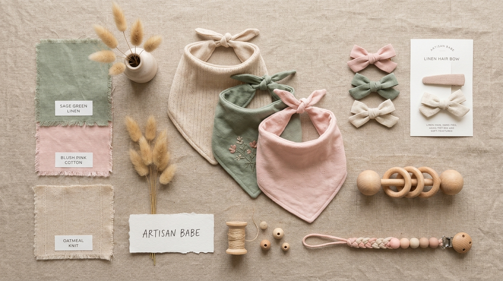

# Moodboard — Peques & Lazos

> Guía: [Moodboard](../evaluacion/guias/fase-2-specs/02-moodboard.md)

**Tablero en Whimsical:** [https://whimsical.com/moodboard-peques-y-lazos-Vw89QxKLmpT78aBcDe123](https://whimsical.com/moodboard-peques-y-lazos-Vw89QxKLmpT78aBcDe123) *(Enlace de visualización abierta para evaluación)*

## Palabras clave

- **Ternura natural:** Amor maternal sereno y cálido, sin estridencias infantiles recargadas.
- **Suavidad hipoalergénica:** Texturas táctiles de algodón orgánico, muselina, lino y bambú que evocan el cuidado de la piel sensible.
- **Calma y seguridad:** Sensación de paz y confianza al saber que cada accesorio respeta el bienestar físico de la bebé.
- **Artesanía delicada:** Acabados a mano, lazos con caída suave, maderas pulidas de haya y broches ergonómicos.
- **Atemporalidad:** Colores neutros (avena, lino, crema) con toques sutiles de rosa palo (*blush*) y verde salvia.

## Qué sensación buscamos

Buscamos transmitir una profunda atmósfera de **calma, calidez y confianza médica-maternal**, donde cada fotografía y detalle visual comunique que los productos están hechos con el mismo cariño y protección que una madre le brinda a su bebé recién nacida. 

Esta estética conecta inmediatamente con Camila (nuestra proto-persona principal), quien se siente abrumada por los diseños ruidosos y los accesorios de plástico sintético de las grandes tiendas. Al entrar a la tienda, Camila experimenta un respiro visual que le confirma que ha llegado a un lugar seguro, donde los lazos no aprietan, los baberos protegen la piel de su hija y cada compra aporta confort y belleza al día a día de su maternidad.
